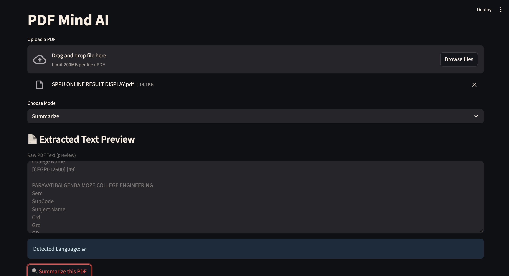
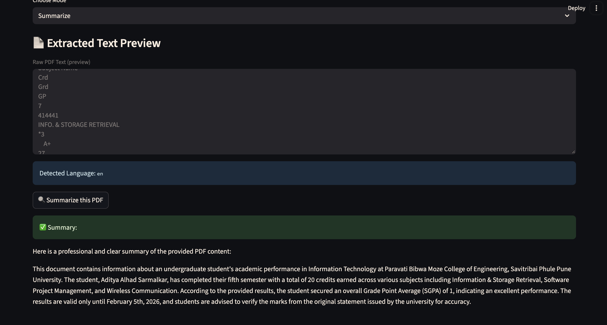
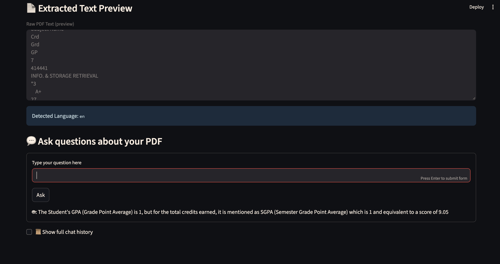

# PDF Mind

**PDF Mind** is an AI-powered document intelligence platform that enables users to upload PDF files, generate concise summaries, and interact with their documents through an intuitive chat interface. It leverages a locally hosted LLM through **Ollama** to extract document content and generate context-aware responses based on the uploaded PDF. By processing information locally, the platform prioritizes data privacy and minimizes the risks associated with storing sensitive document content on external cloud services. The application is built using **Streamlit** for its interactive user interface.

  

  

  

